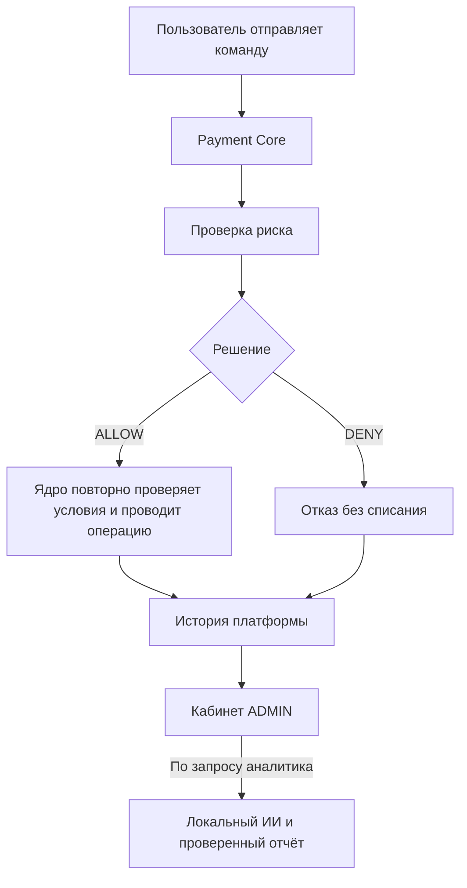

# Payment Intelligence Platform

Учебная платформа анализа платежей: Java 21 / Spring Boot, PostgreSQL и React. Первый выпуск рассчитан на закрытый пилот с тестовыми средствами и интеграцию с существующим Java-приложением Payment Core.

**Реализованы события, правила риска, проверка до списания, кабинет ADMIN и локальный ИИ-анализ.** При отказе или сбое антифрода ядро не проводит расходную команду; повтор сохраняет исходную попытку. ИИ работает в фоне и объясняет сохранённые факты. Для этапов 7–8 добавлены [запуск Ollama и воспроизводимое испытание пилота](docs/stages-7-8.md). Фактические результаты и ограничения — в [прогрессе](docs/progress.md), порядок разработки — в [плане](docs/implementation-plan.md).

## Как устроена программа и что она делает

Программа создаёт систему контроля и анализа платежей. Она проверяет операции до списания, сохраняет причины решений, помогает администратору расследовать подозрительные попытки и получать объяснения от локального ИИ.

Всё работает с тестовыми средствами. Денежные операции выполняет **Payment Core**, а **Payment Intelligence Platform** отвечает за риск и аналитику. Ядро запускается отдельным приложением; этот репозиторий содержит платформу и документацию её интеграции.



### 1. Основа проекта: из каких частей состоит программа

| Часть | Назначение |
| --- | --- |
| Payment Core | Кошельки, остатки, комиссии, переводы, резервы и проводки |
| Java / Spring Boot платформы | Проверка риска, обработка событий, расследования и задания ИИ |
| React-интерфейс | Страницы состояния и кабинет аналитика |
| PostgreSQL платформы | История попыток, решения риска, расследования и отчёты |
| Ollama с Qwen3 | Локальное выполнение ИИ-анализа |

У ядра и платформы свои базы данных. Платформа получает информацию через API и события. Суммы хранятся целыми копейками; в JSON передаются строками: `"amount_minor": "15000"` означает 150 рублей.

### 2. Каркас приложения: запуск и проверка состояния

Эта часть позволяет понять, запущено ли приложение и доступна ли его база. Есть отдельные проверки работы HTTP-приложения и готовности обслуживать запросы с использованием БД. Поэтому работающая страница ещё не означает, что база исправна.

Backend платформы использует порт `8081`, PostgreSQL — `5435`, сервер разработки интерфейса — `5174`.

Flyway автоматически применяет новые миграции — последовательные изменения структуры БД. Ошибки API возвращаются в едином формате с кодом и идентификатором запроса, по которому можно искать проблему в журнале.

### 3. События и история операций

После проведения операции ядро передаёт сведения платформе. Для этого используется **transactional outbox** — таблица исходящих событий. Операция и запись о необходимости отправить событие сохраняются одной транзакцией. Затем фоновый отправитель доставляет событие по HTTP.

Если платформа временно недоступна, событие остаётся для последующей доставки. Повторно полученное событие распознаётся и не создаёт вторую запись. Версии событий защищают историю от неправильного порядка получения.

Есть также импорт прежней истории из ядра и повторное построение витрины — удобного представления операций для аналитика. Событие отказа риска хранится отдельно от фактического движения денег.

### 4. Антифрод: как определяется риск

Сейчас риск рассчитывается по четырём заданным правилам.

| Правило | Условие | Баллы |
| --- | --- | ---: |
| `HIGH_AMOUNT` | Сумма от 100 000 ₽ | 70 |
| `HIGH_VELOCITY` | Пятая и последующая уникальная расходная попытка за 60 секунд | 80 |
| `RECIPIENT_FANOUT` | Три и более разных получателя переводов за 10 минут | 40 |
| `NEW_ACCOUNT_LARGE_AMOUNT` | Пользователю менее 24 часов, сумма от 25 000 ₽ | 30 |

Баллы складываются, максимум — **100**. От **70 баллов** возвращается `DENY`, ниже — `ALLOW`.

Например, у нового пользователя перевод на 30 000 ₽ даёт 30 баллов. Если одновременно срабатывает правило нескольких получателей, добавляются ещё 40: получается 70 и операция отклоняется, даже если другие правила не сработали.

Частота учитывает также попытки, уже отклонённые антифродом. Повтор одной команды не считается новой попыткой. Одновременные запросы одного кошелька согласуются через блокировки БД.

**Баллы показывают результат правил, а не вероятность мошенничества.** Вместе с решением сохраняются причины, использованные факты и версия правил. Правила не являются обученной ML-моделью.

### 5. Проверка до списания и защита от повторов

Для перевода, вывода и окончательного списания резерва ядро сначала проверяет запрос и права пользователя. Затем сохраняет идентификатор попытки и обращается к антифроду.

| Результат | Поведение |
| --- | --- |
| `ALLOW` | Ядро повторно проверяет условия, права и баланс, затем выполняет операцию |
| `DENY` | Возвращается `409 RISK_REJECTED`, списания нет |
| Проверка недоступна или ответ некорректен | Возвращается `503 RISK_UNAVAILABLE`, списания нет |

`ALLOW` ещё не гарантирует успешный платёж: например, средств может оказаться недостаточно. HTTP-проверка риска выполняется до получения денежных блокировок; ядро также проверяет срок разрешения перед проведением.

От повторного списания защищает **ключ идемпотентности** — постоянная метка конкретной команды. Повтор успешной команды с тем же ключом возвращает сохранённый результат. Использование того же ключа с другими параметрами вызывает конфликт. После технического сбоя разрешён повтор исходной команды с исходным ключом. Окончательный отказ риска сохраняется для этого ключа.

Если антифрод отклонил списание резерва, резерв остаётся активным. Его отмена и истечение продолжают работать независимо от доступности проверки риска. Административные тестовые пополнения и возвраты также не блокируются этими правилами.

### 6. Кабинет аналитика и расследования

Существующий `ADMIN` ядра открывает кабинет по адресу `/intelligence/`. Права проверяются при каждом запросе. Изменяющие браузерные запросы защищены CSRF — проверкой, которая помогает предотвращать выполнение действий со стороннего сайта от имени пользователя.

В кабинете доступны:

- сводка попыток, отказов, операций и расследований;
- поиск по идентификаторам и фильтры по времени, типу команды и решению;
- карточка попытки с суммой, комиссией, причинами риска и историей оценок;
- подтверждённый результат ядра и связанные операции;
- очередь расследований и история действий аналитиков.

Для отказа риска создаётся одно расследование. Его состояния: `OPEN` — открыто, `IN_REVIEW` — в работе, `CLOSED` — закрыто.

При закрытии аналитик выбирает вывод: подозрительно, легитимно или недостаточно данных. Сохраняются комментарий, автор и время изменения. Ручной вывод сохраняется отдельно от исторического решения риска; отклонённая денежная команда автоматически не возобновляется. «Подозрительно» означает оценку аналитика, а не подтверждённое мошенничество.

### 7. Локальный ИИ: что он действительно делает

Аналитик запрашивает анализ из карточки попытки. Задание сохраняется в очереди и выполняется в фоне.

ИИ получает ограниченный снимок данных: сведения о попытке, решении, сработавших правилах и до пяти связанных операций. Перед каждым инструментом чтения заново проверяются текущие права автора в ядре.

**Модель выбирает подтверждающие факты и рекомендации из разрешённого каталога.** Сервер проверяет структуру ответа, существование ссылок и наличие обязательных свидетельств. Русский текст фактов формируется из сохранённых данных.

Отчёт содержит объяснение, факты, ограничения вывода и рекомендации. Сохраняются модель, её версия, параметры и происхождение данных. Полномочия агента ограничены чтением разрешённых фактов; рекомендации рассматривает человек.

Одновременно выполняется одна генерация; допускается до восьми активных заданий. Генерация по умолчанию выключена. При ошибке модели показывается явно обозначенное **объяснение по правилам**. Расчёт `ALLOW` и `DENY` продолжает работать независимо от ИИ.

### 8. Пилот: как проверялась работа всей системы

Проверялись отказы без списания, конкурентные запросы, повторы, перезапуски, восстановление доставки, права доступа, интерфейс и настоящая локальная модель.

Обе тестовые БД копировались и восстанавливались в отдельные пустые базы. После восстановления сравнивались данные, выполнялась денежная сверка и проверялись прежние ключи команд. Старые браузерные сессии аннулировались.

В последнем зафиксированном локальном прогоне **01.11.2026** прошли **110 backend-тестов, 14 Vitest, 6 Playwright и 22 группы сквозных проверок**. Backend-тесты включают оба проекта: платформу и Java-ядро. При 5 запросах/с p95 оценки риска составил около 33 мс без генерации и 84 мс в коротком параллельном замере; проверенное событие дошло до витрины примерно за 528 мс. Это результаты конкретных коротких испытаний, не гарантия длительной производительности.

Длительная эксплуатация и внешнее хранилище резервных копий ещё требуют проверки; на компьютере с 8 ГБ памяти запас остаётся небольшим. Подробные результаты, ограничения и история проверок находятся в [прогрессе](docs/progress.md).

### Где искать функциональность в исходниках

| Где смотреть | Что находится |
| --- | --- |
| `src/main/java/com/kamerzing/payment_intelligence/risk/` | Правила, счётчики и сохранение решений |
| `src/main/java/com/kamerzing/payment_intelligence/integration/` | Приём событий и импорт истории |
| `src/main/java/com/kamerzing/payment_intelligence/investigations/` | Поиск, карточки, расследования и аудит изменений |
| `src/main/java/com/kamerzing/payment_intelligence/ai/` | Очередь, инструменты чтения, Ollama и проверка отчётов |
| `src/main/java/com/kamerzing/payment_intelligence/common/`, `config/` | Ошибки, состояние приложения и защита API |
| `web/src/` | Пользовательский интерфейс |
| `src/main/resources/db/migration/` | Структура БД и её изменения |

В Java-коде `Controller` принимает HTTP-запрос, `Service` выполняет прикладную логику, а `Repository` читает и сохраняет данные через SQL.

## Быстрый запуск в Windows

Нужны JDK 21, Node.js 24 с npm и работающий Docker Desktop с Linux containers. Выполняйте команды из корня проекта. Порты платформы: backend `8081`, PostgreSQL `5435`, Vite `5174`; порты ядра не изменяются.

```powershell
$env:JAVA_HOME='C:\Program Files\Java\jdk-21.0.12.1'
$env:PATH=$env:JAVA_HOME+'\bin;'+$env:PATH
.\scripts\init-local.ps1
docker info
docker compose up -d --wait postgres
.\gradlew.bat --no-daemon bootRun --args="--spring.profiles.active=local-lite"
```

Скрипт создаёт `.env` со случайным паролем и сохраняет уже существующий файл. Не публикуйте его. Пароль применится при первом создании БД; изменение `.env` не меняет пароль в существующем volume. Если политика PowerShell запрещает локальный скрипт, используйте разовый запуск `powershell -NoProfile -ExecutionPolicy Bypass -File .\scripts\init-local.ps1` без изменения системной политики.

В другом терминале запустите панель:

```powershell
cd web
npm.cmd ci
npm.cmd run dev
```

Откройте [панель](http://127.0.0.1:5174/). Vite передаёт запросы состояния backend. После `bootRun` доступны [status](http://127.0.0.1:8081/api/v1/status), [readiness](http://127.0.0.1:8081/actuator/health/readiness), [liveness](http://127.0.0.1:8081/actuator/health/liveness) и локальный [Swagger UI](http://127.0.0.1:8081/swagger-ui/index.html).

При `bootRun` UI обслуживается Vite; в готовом JAR панель уже включена и доступна на порту backend. После успешной сборки его можно запустить:

```powershell
java -Xmx384m -jar build/libs/payment-intelligence-platform.jar --spring.profiles.active=local-lite
```

Если backend или БД недоступны, панель показывает соответствующий статус. Зелёный статус HTTP-приложения сам по себе не означает готовность БД: readiness проверяется отдельно. Доставку событий ядра проверяют отдельно; панель не делает вывод о соединении по наличию кода. ИИ выключен.

## События и антифрод

Порядок настройки проверки до списания и кабинета: [инструкция этапов 5–6](docs/stages-5-6.md). События, импорт и генератор сценариев описаны в [инструкции интеграции](docs/integration.md). Внутренние DTO закреплены в [OpenAPI](docs/openapi/internal-v1.yaml), API аналитика — в [analyst-v1.yaml](docs/openapi/analyst-v1.yaml).

Для межсервисных секретов выполните `.\scripts\init-integration.ps1`. Если файл создан ранее, добавьте отдельный секрет шлюза командой `.\scripts\init-analyst.ps1`. Файл `.env.integration` не заменяет `.env` и не попадает в Git. Без секрета внутренние API отвечают 401, а новые списания ядра — `503 RISK_UNAVAILABLE`.

Войдите ADMIN в Payment Core и откройте [кабинет аналитика](http://127.0.0.1:8080/intelligence/). Для шлюза запустите платформу из собранного JAR; её отдельная страница на 8081 показывает состояние. Авторизация и CSRF остаются в ядре, текущие права проверяются при каждом запросе.

ИИ запускается из карточки попытки. По умолчанию генерация выключена; вместо неё сохраняется явно обозначенное объяснение по правилам. Для настоящей модели запустите `scripts/start-ollama.ps1`, загрузите `qwen3:4b-instruct`, выполните `node scripts/prepare-ai.mjs` и включите `PIP_AI_ENABLED=true` при запуске платформы. Полная [инструкция этапов 7–8](docs/stages-7-8.md) включает закрепление digest/runtime, лимиты, очередь, проверку фактов и сценарий восстановления. При недоступности модели правила риска продолжают работать.

Сквозная проверка двух собранных JAR: `node scripts/integration-smoke.mjs`. Нужны JDK 21, Docker, зависимости `web` и Chromium (`npm exec playwright -- install chromium` из `web`). По умолчанию JAR ядра берётся из соседнего `../payment-core/payment-core2/build/libs/payment-core.jar`; другой путь задаётся через `PIP_CORE_JAR`. Скрипт создаёт временный PostgreSQL с отдельными БД/ролями, проверяет денежную защиту, расследование, доставку, импорт, повторы и перезапуск, затем удаляет только свой тестовый контейнер. Рабочие `.env`, БД и volumes не используются.

## IntelliJ IDEA

1. `File → Open`: выберите корень `payment-intelligence-platform` и импортируйте Gradle-проект, используя Wrapper.
2. `Project Structure → Project SDK`: выберите **JDK 21**. На исходном ПК это `C:\Program Files\Java\jdk-21.0.12.1`.
3. `Settings → Build Tools → Gradle → Gradle JVM`: также выберите **JDK 21**. Java терминала может отличаться; проверяйте `java -version` отдельно.
4. Подготовьте `.env` и запустите PostgreSQL командами выше.
5. Выберите конфигурацию **Backend Lite**. Она использует профиль `local-lite`, корень проекта как рабочую папку и heap 384 МБ.
6. Конфигурация **Backend Tests** запускает `test` без Docker, Node.js и модели. Панель запускайте из терминала `web`.

Если IDEA не разрешила модуль конфигурации, дождитесь Gradle Sync и выберите модуль `payment-intelligence-platform.main`. Общие конфигурации находятся в `.run`; локальные `.idea` не входят в Git. Платный мастер создания Spring-проекта не требуется: открывается готовый Gradle-проект.

## Проверки и сборка

Backend-проверки без Docker, npm и ИИ:

```powershell
.\gradlew.bat --no-daemon test
```

Интеграционные проверки запускают изолированный PostgreSQL через Testcontainers и **не используют `.env` или рабочую БД**:

```powershell
docker info
.\gradlew.bat --no-daemon integrationTest
```

Полная сборка запускает backend-тесты, PostgreSQL-тесты, frontend-тесты и включает собранную панель в JAR:

```powershell
.\gradlew.bat --no-daemon build
```

Отдельно в `web`: `npm.cmd test`, `npm.cmd run build`. Для браузерных сценариев один раз установите Chromium командой `npx.cmd playwright install chromium`, затем выполните `npm.cmd run test:e2e`. Эти сценарии проверяют интерфейс с управляемыми HTTP-ответами; реальная БД проверяется задачей `integrationTest`.

При работающем JAR и БД запустите из корня `node scripts/smoke.mjs`: проверяются встроенные JS/CSS, readiness/liveness, закрытые API, ошибки и локальная документация. Отчёт сохраняется в `build/smoke.json`.

На Linux/macOS используйте `sh gradlew` и `npm` вместо Windows-команд. В GitHub Actions настроены JDK 21, Node.js 24, PostgreSQL Testcontainers и Chromium. Workflow запускается при push в `main`, pull request или вручную. Актуальные результаты доступны во вкладке [Actions](https://github.com/Kamerzing/payment-intelligence-platform-Antifrod-/actions); сам файл workflow не подтверждает успешный прогон.

## Остановка и сохранность данных

Приложение и Vite остановите через `Ctrl+C`. Команда `docker compose down` остановит PostgreSQL и сохранит volume. Не используйте `down -v` для обычной остановки. Имена Compose и volume платформы отличаются от ядра.

На ПК с 8 ГБ RAM работайте последовательно: сборки и тяжёлые проверки отдельно от модели. Краткий пилотный прогон и снимки ресурсов описываются в прогрессе; они не подтверждают запас памяти для длительной одновременной работы. Локальные адреса остаются на loopback.
