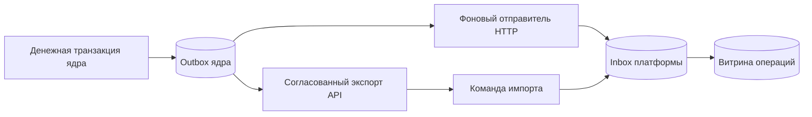

# События, импорт и правила: этапы 3–6

Это локальная интеграция Java Payment Core с платформой. Средства тестовые. Ядро остаётся единственным владельцем денег. Проверка риска подключена к переводам, выводам и списанию резервов. Кабинет ADMIN и денежный протокол описаны в [инструкции этапов 5–6](stages-5-6.md).



Событие сохраняется вместе с деньгами, а доставка выполняется отдельно. Правила риска используют собственные синхронные счётчики попыток; витрина не управляет ограничением частоты.

## Доступ и запуск

1. Подготовьте обычную БД по README. Выполните `scripts/init-integration.ps1`: отдельный `.env.integration` получит три случайных секрета по 256 бит. Повтор сохраняет файл; `.env` не изменяется. Не включайте эти файлы в Git.
2. Платформа с профилем `local-lite` читает `.env.integration` автоматически. `PIP_CORE_TOKEN` разрешает только POST событий и оценки риска. Без секрета длиной хотя бы 32 символа внутренние маршруты отвечают 401. Браузерная сессия и роль ADMIN не заменяют этот секрет.
3. Для ядра передайте тот же файл как дополнительную конфигурацию. В терминале ядра с JDK 21:

```powershell
$env:SPRING_CONFIG_ADDITIONAL_LOCATION='optional:file:C:/Users/ww/Documents/Codex/payment-intelligence-platform/.env.integration[.properties]'
$env:PAYMENT_INTELLIGENCE_DELIVERY_ENABLED='true'
.\gradlew.bat --no-daemon bootRun --args="--spring.profiles.active=local"
```

Путь измените для другого компьютера. `PIP_EXPORT_TOKEN` разрешает только создание и чтение экспорта ядра; он отличается от секрета доставки. Отправитель выключен по умолчанию. Не передавайте секреты аргументами команды или в браузер. Внутренние HTTP-маршруты не используют cookie; CSRF для браузерных API остаётся включённым. Локальные адреса — только `127.0.0.1`.

## Контракт событий

Точная схема и примеры: [OpenAPI](openapi/internal-v1.yaml). `POST /internal/v1/events` возвращает 200 с `event_id` и `ACCEPTED`/`DUPLICATE` только после commit. Один `event_id`, позиция потока или версия объекта с другим содержимым дают 409 `EVENT_CONFLICT`. Неизвестная схема и неверные данные дают 400. Данные аналитика через этот API не читаются.

Миграция V6 ядра добавляет AFTER-триггер перехода `DRAFT → POSTED`: событие и проводки фиксируются одной транзакцией. В событии есть сумма, комиссия, кошельки, тип, автор и время операции; паролей и HTTP-запроса нет. Старые операции получают события при миграции. Для неизменяемой операции текущая `source_version` равна `"1"`. Создание/освобождение резерва видно как отдельный тип операции, а не как перевод получателю. V7 добавляет `attempt_id` и `decision_id` для новых проведённых расходных команд и `RISK_REJECTED` для окончательного отказа. Исторические события не переписываются; [денежный протокол](stages-5-6.md).

Отправитель раз в секунду забирает до 10 готовых событий. Захват с `SKIP LOCKED` сохраняет аренду на 5 секунд и завершает транзакцию **до HTTP**. Ожидание HTTP ограничено секундой. Успех требует корректного подтверждения с тем же ID. Ошибка оставляет событие в БД; задержка повторов растёт до 300 секунд. Перезапуск продолжает с сохранённой аренды. Удаления или окончательной потери события после нескольких неудач нет. Доставка — как минимум один раз, порядок не гарантируется.

Платформа атомарно сохраняет исходное событие и обновляет `operation_view` только при большей `source_version`. Исходные события неизменяемы. Витрина не заменяет денежный журнал. Её можно заново построить из сохранённых событий:

```powershell
java -Xmx384m -jar build/libs/payment-intelligence-platform.jar --spring.profiles.active=local-lite --rebuild-view
```

## Согласованный импорт истории

Ядро предоставляет `POST /internal/v1/exports` и `GET /internal/v1/exports/{export_id}?limit=100&after_operation_id=...`. Экспорт материализуется в собственной БД ядра на одном снимке `REPEATABLE READ`; HTTP-страницы читают уже сохранённый снимок. Лимит — 1–100, порядок — UUID операции. Экспорт не даёт платформе доступа к таблицам ядра.

Позиция потока выделяется транзакционным счётчиком под блокировкой, поэтому более поздняя подтверждённая позиция не обгоняет незавершённую транзакцию. Снимок и курсор согласованы. События до курсора могут приходить повторно; события после курсора продолжают доставляться outbox. Импорт не помечает outbox доставленным и не отключает поток. Пропуска между снимком и доставкой нет, пока сохранены outbox и экспорт. Автоматическая очистка этих данных не реализована.

При запущенном ядре и после сборки JAR платформы:

```powershell
java -Xmx384m -jar build/libs/payment-intelligence-platform.jar --spring.profiles.active=local-lite --import-history
```

Команда выводит ID экспорта. После прерывания повторите её с `--export-id=UUID`. Страница и checkpoint сохраняются одной транзакцией; повтор страниц безопасен. Новый запуск без ID создаст новый снимок, дедупликация останется действующей. Локальная команда работает без HTTP-сервера платформы. Для live-доставки сервер платформы должен быть запущен отдельно; на 8 ГБ допустимо сначала импортировать историю последовательно, а доставку проверить отдельным запуском.

## Оценка риска

`POST /internal/v1/risk/evaluations` принимает нормализованную расходную команду и доверенную дату создания пользователя **из ядра**. Точная сумма и комиссия — строки копеек, валюта RUB. У переводов обязателен получатель, у выводов его нет; `hold_id` требуется только для CAPTURE. Сумма положительная, комиссия неотрицательная, итог не превышает `long`. Синтаксически неверный запрос не обновляет счётчики; отсутствующий или будущий контекст не заменяется догадкой.

Четыре правила и баллы сохранены из AGENTS.md. Настройки находятся в `pip.risk.rules` в application.yml. При изменении любого параметра задайте новую `version`; повторное использование версии с другими настройками даёт техническую ошибку. Оценка ограничена 100; DENY начинается с 70. Оценка не является вероятностью мошенничества.

Сначала PostgreSQL блокирует ID попытки, затем строку исходного кошелька. Это защищает и конкурентные повторы с разными кошельками, и уникальные попытки одного кошелька. Факты, попытка и решение сохраняются атомарно. Окна `(now − window, now]` используют серверный UTC после получения блокировки. Отказы учитываются. Получатели — разные целевые кошельки TRANSFER/CAPTURE_TRANSFER; выводы не добавляют получателя.

Повтор с изменёнными параметрами даёт 409 `ATTEMPT_CONFLICT`. Сохранённый DENY воспроизводится бессрочно, включая обновление правил. ALLOW действует одну секунду и только при той же версии правил. Истёкшее разрешение или новая версия правил вызывают новую оценку без новой строки попытки: текущая попытка учитывается один раз даже за пределами первоначального окна. История прежних решений сохраняется. `command_hash` — SHA-256 канонического JSON DTO сервера; ядро сравнивает возвращённые связи/параметры и сроки, а не самостоятельно хешировать произвольный JSON браузера.

Оба решения возвращаются внутреннему вызывающему сервису с HTTP 200. Преобразование DENY в пользовательский `409 RISK_REJECTED` и технических ошибок в `503 RISK_UNAVAILABLE` выполняет ядро. ALLOW само по себе не проводит деньги и не гарантирует достаточный баланс.

Генератор синтетических запросов:

```powershell
# PIP_CORE_TOKEN заранее передаётся через окружение из локальной конфигурации, без печати.
node scripts/risk-scenarios.mjs
```

Он создаёт тестовые попытки в БД платформы: порог суммы, повтор DENY, конфликт, пятая попытка, три получателя нового пользователя. Денег и операций ядра не создаёт. Запускайте на тестовой БД; сценарии остаются в истории.

## Ограничения

Кабинет аналитика, шлюз ADMIN, расследования, события отказов и денежная проверка реализованы на этапах 5–6; [инструкция](stages-5-6.md). ИИ пока не подключён. Показатели p95/5 запросов в секунду, полный стенд на 8 ГБ и обслуживание очень большой истории требуют отдельных измерений. Материализованный экспорт и глобальный счётчик рассчитаны на локальный пилот.
